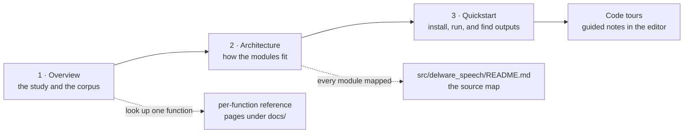

# The Delaware Speech NLP book

Read in order for a guided tour, or jump to a page. Browse the [function
reference](../docs/INDEX.md) or [module map](../src/delware_speech/README.md).

## Reading map

## Pages

1. **[Overview](overview.md)** — the study being replicated, the corpus, and what the
   pipeline produces. Start here.
2. **[Architecture](architecture.md)** — how the modules fit together, the data flow
   from `.cha` transcripts to figures, and the design decisions worth knowing before
   changing code.
3. **[Quickstart](quickstart.md)** — install, point the pipeline at the Delaware
   dataset, run all or part of it, and find the outputs.

## Code tours

The `.tours/` directory holds [VS Code Code Tour](https://marketplace.visualstudio.com/items?itemName=vsls-contrib.codetour)
walkthroughs: JSON files that pin guided notes to specific lines of the code, so you
can re-read the pipeline inside the editor later. Install the **Code Tour** extension,
open the CodeTour view (or run **CodeTour: Start Tour** from the command palette), and
pick a tour — `00 Start here` chains into all the others in reading order.

| Tour | Covers |
|------|--------|
| `00 Start here` | The four documentation surfaces and where the code starts |
| `01 CLI entry point` | `main.py`: stage flags, caching, and the in-memory hand-off |
| `02 Ingest: transcripts and demographics` | `chat_reader.py`, `demographics.py` |
| `03 Assembly: the pipeline` | `pipeline.py`: per-file records, the two frames |
| `04 Features: 53 measures from text` | `features.py`: the extraction engine |
| `05 Analysis: group differences and MoCA` | `statistical_analysis.py` |
| `06 Clustering and importance` | `clustering.py`, `importance.py` |
| `07 Visualization` | `visualization.py`: the six figure functions |

Every tour step's file/line anchor is machine-checked by `tests/test_tours.py`, so a
code change that moves an annotated line fails the suite until the tour is revisited.

## What this repository is, in one paragraph

A faithful Python re-implementation of the analysis in Nyongesa et al. (2025), which
extracted 53 linguistic features from picture-description speech on the DementiaBank
Delaware corpus and used them to characterize and classify Alzheimer's disease and
MCI. The original study shipped numbered Python scripts and three R scripts; this
repository reorganizes the same analysis into one importable package
(`src/delware_speech/`), driven by a single CLI (`main.py`), with unit tests and
deterministic seeds. The original scripts are kept for comparison in
`reference_repo/speech/`.

## Reading paths

| If you want to… | Read |
|---|---|
| Understand the study and its claims | `book/overview.md` |
| Review or modify the code | `src/delware_speech/README.md`, then `book/architecture.md` |
| Look up one function's behavior | the per-function reference pages (linked from `src/delware_speech/README.md`) |
| Run the pipeline on data | `book/quickstart.md` |
| Get guided notes inside the editor | the `.tours/` walkthroughs (see **Code tours** above) |
| Compare against the original R/Python scripts | `reference_repo/speech/` |
