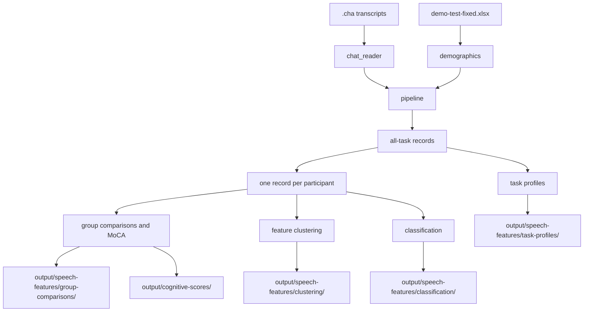

[Book index](README.md)

# Architecture

The pipeline turns CHAT transcripts and a demographics workbook into analysis tables and figures.

## Data flow

## Stages

| Stage | Module | What it does |
|-------|--------|--------------|
| Read | `chat_reader`, `demographics` | Parse CHAT speech and harmonize workbook fields. |
| Assemble | `pipeline` | Build all-task and unique-participant data frames. |
| Extract | `features` | Return 53 measures in 63 columns for each task record. |
| Analyze | `statistical_analysis`, `clustering`, `importance` | Compare groups, relate speech to MoCA, cluster features, and classify diagnosis. |
| Plot | `visualization` | Render figures from the frames and analysis results. |

## Behavior to know

- Workbook fields replace transcript-header metadata when participant IDs match. If the workbook is missing, header values are used; missing diagnosis defaults to `Control`. Check the demographics path before trusting results.
- Person-level analyses use one record per participant, prioritized `Cookie`, then `Cat`, then `Rockwell`. The task radar uses all task records.
- Filled pauses are kept during CHAT cleaning because disfluency is a study feature.
- Classifier medians are imputed before cross-validation; scaling is fit within each fold. See the [importance reference](../docs/reference/importance.md) for this trade-off.
- The correlation heatmap can be recomputed when clustering is skipped. The feature-importance plot needs importance results in the same run.

The CLI stages and cache behavior are in the [quickstart](quickstart.md). Module details are in the [source map](../src/delware_speech/README.md).

[Previous: Overview](overview.md) · [Next: Quickstart](quickstart.md)
