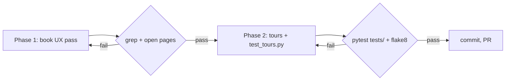

# Plan: book UX/UI and code tours

Plan: how the SPEC in this folder will be delivered, in what order, and what could go wrong.

<abstract>

Two phases, both documentation-only. Phase 1 reworks the four `book/` pages for navigation and rendering (breadcrumbs, reading order, Mermaid architecture diagram, GitHub alerts). Phase 2 authors the `.tours/` walkthroughs anchored to the real source lines and adds the pytest validation that keeps every step's `file`/`line` honest. Riskiest step: tour anchors drifting from the code they describe — mitigated by generating anchors from the actual files and by the machine check.

</abstract>

<approach>

## Approach

Phase 1 (book) is self-contained Markdown work and lands first so the index exists to link the tours when they arrive. Phase 2 (tours) reads each module, picks the symbols worth stopping at, writes the tour JSON with 1-based line anchors taken from the current working tree, and adds `tests/test_tours.py` so anchors are re-validated on every test run. The two phases share no code and could run in parallel, but the book README's tours section (phase 2) edits a file phase 1 rewrites, so phase 1 goes first to avoid a conflicting edit.

Components:

- `book/README.md` — index rewrite: reading order with per-page descriptions, a Mermaid reading-map, tours section, alerts where caveats exist.
- `book/overview.md`, `book/architecture.md`, `book/quickstart.md` — breadcrumb header, "what you'll learn" opener, prev/next footer; architecture gains the Mermaid module graph (ASCII art removed, information parity required by SPEC R2); quickstart's troubleshooting table gets one `[!WARNING]`.
- `.tours/*.tour` — eight tours: `00-start-here` (primary, chains to next), `01-entry-point` (main.py), `02-ingest` (chat_reader, demographics), `03-pipeline` (pipeline), `04-features` (features), `05-analysis` (statistical_analysis), `06-clustering-importance` (clustering, importance), `07-visualization` (visualization) — chained by `nextTour` in book page order.
- `tests/test_tours.py` — schema + anchor validation for every tour file.

## Phases

Milestones, referenced by TASKS.md:

| Milestone | Phase | Delivers | Checkpoint |
|-----------|-------|----------|------------|
| M1 | 1 | Book pages navigable, Mermaid architecture diagram rendering, alerts in place | Open each page; grep for breadcrumb/prev-next/`mermaid` fence; SPEC SC4 |
| M2 | 2 | Eight tour files + validation test, tours documented on the index | `pytest tests/test_tours.py` and full `pytest tests/`; SPEC SC1–SC3 |

</approach>

<risks>

## Risks

| Risk | Likelihood | Mitigation |
|------|------------|------------|
| Tour line anchors point at the wrong statement (drift from code) | medium | Anchors taken from the current files during authoring; `tests/test_tours.py` asserts each anchor's line is non-empty and within bounds; future code edits that shift lines fail the test loudly, forcing the tour to be revisited |
| Mermaid diagram loses information vs the ASCII art | low | SPEC R2 enumerates the required nodes and edges; review compares against the ASCII original before it is removed |
| GitHub alerts overused, hurting readability | low | Cap of one or two per page (RESEARCH finding 2); SPEC R3 check counts them |
| Docs changes accidentally touch `src/` | low | Phase work is file-scoped; SC5 greps the diff for `src/` and `main.py` |

</risks>

<verification>

## Verification

| SPEC criterion | Command / observation |
|----------------|------------------------|
| SC1 tours valid | `/home/ducvu/.conda/envs/alzheimer-speech/bin/pytest -v tests/test_tours.py` |
| SC2 suite green | `/home/ducvu/.conda/envs/alzheimer-speech/bin/pytest -v tests/` |
| SC3 lint clean | `/home/ducvu/.conda/envs/alzheimer-speech/bin/flake8 src/ tests/ --max-line-length=120 --extend-ignore=E203,W503` |
| SC4 navigation/diagram/alerts | Open `book/*.md`; grep `mermaid`, `[!WARNING]`, prev/next links |
| SC5 no product code touched | `git diff --stat -- src/ main.py` empty for this change |
| SC6 docs complete | `ultragentic docs check docs/features/improve-ux-ui-book` |

</verification>

<revisions>

## Revisions

Appended by `ultragentic docs revise <this file> "<what changed>"`. Do not edit dates by hand.

| Date | Change |
|------|--------|
| 2026-10-15 | Created. |
| 2026-10-15 | Build phase found the natural tour set is eight files (orientation + seven module tours), not seven; risk table updated for the anchor-drift test. |

</revisions>
