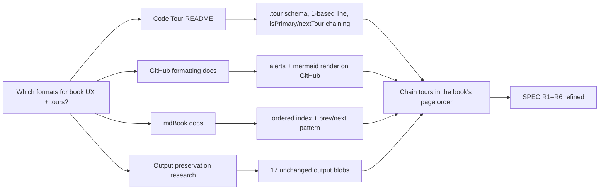

# Research: documentation UX, code tours, and output preservation

Research digest: a question answered from cited sources, with what they mean for this work.

<abstract>

The book and tours use GitHub Markdown and VS Code Code Tour conventions documented by their primary sources. The delivery also groups existing analysis outputs; its preservation check uses Git object identity, described in the [output preservation research](../organize-output-by-feature/RESEARCH.md). These sources support the chosen formats and the file-move check.

</abstract>

<question>

## Question

Which file format and Markdown features should the book UX and `.tour` annotations use, and how can the output moves be checked for content preservation?

Sub-questions:

1. What is the exact JSON schema of a Code Tour `.tour` file, and which directory does the extension scan?
2. Does GitHub Markdown render alert blockquotes (`> [!NOTE]`-style) and Mermaid diagrams, and with what syntax?
3. What navigation conventions do established Markdown book formats (mdBook) use that translate to plain GitHub Markdown?
4. What local evidence confirms moved output files retained their contents?

Scope: primary documentation for the book and tour formats, plus the local Git evidence for output moves. No academic literature is relevant to these documentation and file-preservation checks.

</question>

<findings>

## Findings

1. **Code Tour schema.** Tours are JSON files scanned from a dedicated tours directory at the workspace root (a dot-prefixed directory named for tours; a couple of well-known alternative locations under the editor's config and the repo metadata directory also work). Top level: `title` and `steps` required; optional `description`, `ref`, `isPrimary`, `nextTour`, `when`. Each step: `description` required; optional `file` (workspace-relative path), `line` (1-based), `title`, `directory`, `uri`, `pattern`, `commands`, `view`. Marketplace ID `vsls-contrib.codetour`. ([vsls-contrib/codetour README](https://github.com/vsls-contrib/codetour)) — the README's schema section does not list a `completionEvents` step field, so the plan should not rely on it.
2. **GitHub alerts.** GitHub renders five alert types as blockquotes: `> [!NOTE]`, `> [!TIP]`, `> [!IMPORTANT]`, `> [!WARNING]`, `> [!CAUTION]`. GitHub advises limiting them to one or two per article; alerts cannot be nested in other elements. ([GitHub basic writing and formatting syntax](https://docs.github.com/en/get-started/writing-on-github/getting-started-with-writing-and-formatting-on-github/basic-writing-and-formatting-syntax))
3. **GitHub diagrams.** GitHub renders Mermaid inside fenced code blocks tagged `mermaid` (documented on the creating-diagrams page). ([GitHub creating diagrams](https://docs.github.com/en/get-started/writing-on-github/working-with-advanced-formatting/creating-diagrams))
4. **Book navigation conventions.** mdBook's reading UX is: a fixed page order defined once (its `SUMMARY.md`), prev/next links on every page, and an index that introduces each page in order. In plain GitHub Markdown the same experience is reproduced with a README index that states the order plus explicit prev/next links at each page's foot. ([mdBook documentation](https://rust-lang.github.io/mdBook/))
5. **Output preservation.** Git blob identity verifies that tracked outputs retained their contents as their paths changed. The dedicated [output preservation research](../organize-output-by-feature/RESEARCH.md) records the Git source and the 17 exact rename records for this change.

## Applicability

| Source | Reuse, reject, or gap | Why |
|--------|-----------------------|-----|
| vsls-contrib/codetour README | Reuse | Defines the exact tour-file JSON this change writes and the workspace directory it is scanned from |
| GitHub formatting syntax (alerts) | Reuse | The callout style the book pages adopt, with the one-or-two-per-page constraint |
| GitHub creating diagrams | Reuse | Confirms the `mermaid` fence renders, replacing architecture.md's ASCII art |
| mdBook documentation | Reuse (conventions only) | Source of the prev/next + ordered-index navigation pattern; the tool itself is rejected (no site build) |
| [Output preservation research](../organize-output-by-feature/RESEARCH.md) | Reuse | Records how Git object identity checks the moved files without rerunning analysis |

## Refine

- SPEC R4/R5 refined: tour steps carry `title`, `file`, `line`, `description` only; no `completionEvents` (undocumented in the schema). `isPrimary` + `nextTour` chain the tours so a newcomer has one entry point.
- Tour chain refined: the primary entry tour (repository orientation) chains into the CLI tour, then ingest, assembly, features, analysis, classification, visualization — mirroring the book's page order so the two reading surfaces reinforce each other.
- SPEC R3 refined: at most one or two alerts per page, per GitHub's own advice.
- Verification refined: a machine check (a new pytest module covering tour files, added under the existing tests directory) guards the schema facts from finding 1, because nothing in-repo currently validates tour files.
- Output verification refined: use the existing file-preservation criterion and Git object identity; the dedicated research record contains the method and evidence.

### Methodological gap

There is no prior in-repo or close-domain precedent for tour files in this workspace — the `write-map-each-feature` run produced prose maps (`src/delware_speech/README.md`, `docs/reference/`) but nothing machine-validated. The mitigation is the new pytest validation rather than a literature fix. For output moves, Git identity confirms byte preservation but does not assess the scientific quality of the results.

### Cross-domain mechanisms

Guided-tour design from physical exhibitions transfers: one clearly marked entry route (`isPrimary` start-here tour), then themed rooms (per-module tours) chained by `nextTour`, each stop labeled with what to look at (`title`) and why it matters (`description`). Progressive disclosure keeps the entry tour short and defers depth to module tours.

## Map

</findings>

<open_questions>

- None.

</open_questions>

<references>

- https://github.com/vsls-contrib/codetour
- https://docs.github.com/en/get-started/writing-on-github/getting-started-with-writing-and-formatting-on-github/basic-writing-and-formatting-syntax
- https://docs.github.com/en/get-started/writing-on-github/working-with-advanced-formatting/creating-diagrams
- https://rust-lang.github.io/mdBook/

</references>

<revisions>

## Revisions

Appended by `ultragentic docs revise <this file> "<what changed>"`. Do not edit dates by hand.

| Date | Change |
|------|--------|
| 2026-10-15 | Created. |
| 2026-10-16 | Added the output preservation check for this delivery run. |

</revisions>
