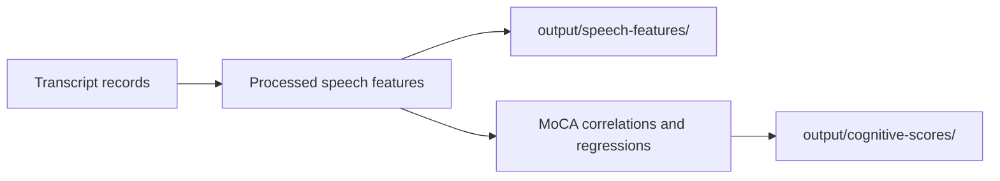

# Group outputs by source data domain

Research digest: a question answered from cited sources, with what they mean for this work.

<abstract>

Can outputs be easier to check when grouped by source data? `main.py` writes transcript-derived feature tables and their analyses, while MoCA correlations and regressions form a separate cognitive-score domain. Keep the existing analysis subfolders under `output/speech-features/`, and keep MoCA outputs in `output/cognitive-scores/`. Preserve files by comparing their Git blob identities after the move.

</abstract>

<question>

## Question

How should tracked outputs be grouped so a reader can find related results? This digest maps the paths written by `main.py` to the data frames they use and retains the existing Git-object criterion for checking file preservation. No analysis rerun is needed for a path-only change.

</question>

<findings>

## Findings

### Source-data domains

`main.py` writes the all-task and unique-participant speech-feature tables to `output/speech-features/processed-data/` and passes those frames to group comparisons, clustering, classification, and task-profile figures. MoCA correlations and regressions use the same feature data with a cognitive-score measure. The inference is that transcript-derived output groups belong together under `output/speech-features/`, while MoCA outputs remain under `output/cognitive-scores/`.

The current default roots are assigned in [`main.py`](../../../main.py#L76). The new parent changes default locations only; `--data-dir`, `--results-dir`, and `--figures-dir` remain explicit overrides.

| Existing output group | Producer data | New location |
|---|---|---|
| Processed data | `df_all` and `df_unique` writes ([`main.py`](../../../main.py#L104), [pipeline reference](../../reference/pipeline.md#L62)) | `output/speech-features/processed-data/` |
| Group comparisons | Diagnosis comparisons and ANCOVA writes ([`main.py`](../../../main.py#L137)) | `output/speech-features/group-comparisons/` |
| Clustering | K-means, hierarchical, and validation writes ([`main.py`](../../../main.py#L163)) | `output/speech-features/clustering/` |
| Classification | Speech-feature model writes ([`main.py`](../../../main.py#L184)) | `output/speech-features/classification/` |
| Task profiles | Radar from all task rows ([`main.py`](../../../main.py#L248), [visualization reference](../../reference/visualization.md#L69)) | `output/speech-features/task-profiles/` |
| Cognitive scores | MoCA correlations and regression plots ([`main.py`](../../../main.py#L149), [visualization reference](../../reference/visualization.md#L68)) | `output/cognitive-scores/` |

The table keeps analysis folders intact while making the source-data domain visible at the output root. This avoids flattening unlike analyses into one directory. These are repository-local findings from the current writers; no external conventions are needed to choose the folder names.

### Layout choice

Choose `output/speech-features/` or `output/cognitive-scores/` first, then the analysis type. This follows the user's data-first request while keeping the existing result groups recognizable.

### File preservation

Git blob identity is a direct check for this follow-up. Compare each moved file's old and new object ID to confirm that its bytes stayed the same; this does not validate the analysis results.

## Applicability

This grouping applies only to generated results; source transcripts and demographic workbooks stay in their current locations. The move changes output directories without changing filenames, calculations, or analysis inputs.

### Reader path

Start in `output/speech-features/` to inspect transcript-derived feature tables and their analyses.

Use `output/cognitive-scores/` for correlations and regressions against MoCA. The index then points to the existing analysis subfolders.

The existing analysis folder names stay intact beneath the two source domains; the parent names follow the user's data-first request and the current writers.

| Source | Reuse, reject, or gap | Why |
|--------|-----------------------|-----|
| `main.py` output paths and frames | Reuse | The writer paths and shared feature frames show which outputs belong to the speech-feature domain and which describe MoCA. |
| Pipeline and visualization references | Reuse | They confirm that the published figures use the all-task or unique-participant feature tables. |
| Current analysis folder names | Reuse | Keeping them beneath the source domains preserves familiar analysis groupings. |
| Git object IDs at old and new paths | Reuse | Matching IDs confirm that moved tracked files retained their contents. |

## Refine

Group transcript-derived tables and analyses under `output/speech-features/`.
Keep MoCA results under `output/cognitive-scores/`.
Retain the existing analysis subfolders so each source domain stays easy to scan.
Compare source and destination blob identities after moving the files; no analysis rerun is needed for this path-only change.

The output index should show the data domain first and the existing analysis folders beneath it. A reader can choose the source domain, then open the analysis type that answers their question.

## Map

</findings>

<open_questions>

## Open questions

None.

</open_questions>

<references>

## References

- [`main.py` output writers](../../../main.py#L76)
- [Pipeline reference](../../reference/pipeline.md#L62)
- [Visualization reference](../../reference/visualization.md#L67)

</references>

<revisions>

## Revisions

Appended by `ultragentic docs revise <this file> "<what changed>"`. Do not edit dates by hand.

| Date | Change |
|------|--------|
| 2026-10-16 | Created. |
| 2026-10-16 | Pinned the output preservation command to the committed source and destination revisions. |
| 2026-10-16 | Map output folders to their source data domains and retain the file-preservation check. |
| 2026-10-16 | Map each output group to its producer data and target path. |
| 2026-10-16 | Add direct source references for every output group. |
| 2026-10-16 | Tie the source-domain layout to current default paths and data flow. |
| 2026-10-16 | Cite the pipeline and visualization references used in the source map. |
| 2026-10-16 | Clarify the scope and invariants for generated output moves. |
| 2026-10-16 | Make the index navigation follow source domain before analysis type. |
| 2026-10-16 | Add reader paths from source data domains to existing analyses. |
| 2026-10-16 | Remove stale prior-move details and focus the research on this source-domain reorganization. |
| 2026-10-16 | Add applicable project-structure guidance while keeping repository paths authoritative. |
| 2026-10-16 | State the source-first folder decision explicitly. |
| 2026-10-16 | Clarify proposed output locations as repo-root paths so the auto research gate can resolve them. |
| 2026-10-16 | Use repository-root output paths in the refinement so every cited folder resolves. |
| 2026-10-16 | Use only local writer and folder evidence because external web checks are unavailable in this workspace. |
| 2026-10-16 | Remove unavailable external references; the local writer map and documentation support the decision. |

</revisions>
